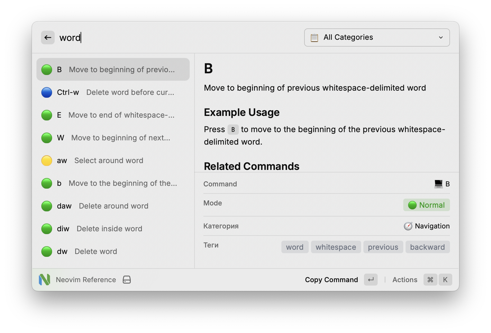

# Neovim Reference для Raycast

[](https://raycast.com/)
[](https://lazyvim.org/)
[](https://neovim.io/)

Быстрая справка по командам **LazyVim** — дистрибутиву Neovim с предустановленным набором дополнений и настроек.

Расширение Raycast даёт мгновенный доступ к отобранным командам и сочетаниям клавиш как для обычного Neovim, так и для возможностей, специфичных для LazyVim. Это позволяет искать нужные команды с минимальным отвлечением от кода, пока вы не выучите нужные наизусть 😇.

**Обратите внимание**: справка заточена под [мою конфигурацию LazyVim](https://github.com/hazadus/nvim-config). В зависимости от вашей конфигурации и установленных дополнений, команды могут отличаться. В таком случае стоит сделать форк и поправить список команд под свои настройки LazyVim/Neovim.

В связи со специфичностью настроек Neovim для каждого пользователя, публикация расширения в сторе Raycast не планируется. Ставьте локально и дополняйте под свои нужды!



## Возможности

### **Поиск и фильтрация**

Вся суть расширения – как можно быстрее найти нужную команду с минимальным отвлечением от работы.

- **Поиск в реальном времени** по командам, описаниям и ключевым словам
- **Фильтр по категории** — просмотр по типу команд
- **Поиск по ключевым словам** — команды находятся по назначению

### **Информация о команде**

- **Описание** для каждой команды
- **Примеры** использования
- **Связанные команды** для дальнейшего изучения
- **Индикаторы режима** с цветовой маркировкой
- **Иконки категорий** для наглядности

### **Статистика использования**

Расширение считает, какие команды вы открываете чаще всего, и помогает собрать из них шпаргалку.

- **Явный подсчёт** — `Enter` (основное действие) или «Mark as Used» (`⌘U`) увеличивает счётчик без копирования в буфер и закрывает окно Raycast; скопировать команду — `⌘C`
- **Неявный подсчёт** — счётчик растёт при копировании команды, примера или полной информации (`⌘C`, `⌘⌥C`, «Copy All Information»)
- **Frequently Used** — при пустом поиске сверху показываются 10 самых частых команд
- **Экспорт шпаргалки** — «Export Cheat Sheet (Markdown)» (`⌘⇧E`) копирует в буфер топ-30 команд, сгруппированных по режимам, для печати или вставки в заметки

Счётчики хранятся локально в `LocalStorage` Raycast, ключ — `Режим:команда`. Если переименовать команду в `src/commands/`, её счётчик обнулится.

### **Разделение по режимам редактора**

В Neovim действие команд отличается в зависимости от включенного режима.

- 🟢 **Normal** — навигация, редактирование, текстовые объекты
- 🔵 **Insert** — ввод текста, автодополнение, навигация
- 🟡 **Visual** — выделение, преобразование, блочное редактирование
- 🔴 **Command-line** — Ex-команды, операции с файлами, конфигурация

### **Категории команд**

Для наглядности, команды разбиты на категории с соответстующими эмоджи.

| Категория | Описание |
|-----------|----------|
| 📁 **Files** | Операции с файлами, буферы, сессии |
| 🧭 **Navigation** | Перемещение, прыжки, метки, прокрутка |
| ✏️ **Editing** | Работа с текстом, отступы, фолдинг |
| 🔍 **Search** | Поиск, замена, grep, шаблоны |
| 🪟 **Windows** | Разделение окон, вкладки, раскладка |
| 📝 **Text Objects** | Операции со словами, абзацами, скобками |
| 🔧 **LSP** | Языковой сервер, диагностика, code actions |
| 🌿 **Git** | Контроль версий, hunks, Lazygit |
| 💻 **Terminal** | Интеграция терминала, команды оболочки |
| 🚀 **LazyVim** | Возможности и сочетания клавиш LazyVim |
| ⚙️ **Misc** | Макросы, проверка орфографии, конфигурация |

## Установка

### Требования

- Установленный [Raycast](https://raycast.com/) на macOS

### Установка из исходников

```bash
# Клонировать репозиторий
git clone https://github.com/hazadus/raycast-neovim-reference.git
cd raycast-neovim-reference

# Собрать расширение
cd neovim-reference
npm install && npm run build

# Импорт в Raycast
# Выполните команду "Import Extension" в Raycast и выберите папку проекта
```

## Использование

### Быстрый доступ
1. Откройте Raycast (`⌘ + Space` по умолчанию)
2. Введите "Neovim Reference" или "nv"
3. Просматривайте или ищите команды

### Советы по поиску
- **По команде**: введите сочетание клавиш (например, "gd", "Ctrl-w")
- **По действию**: опишите, что нужно сделать (например, "delete word", "split window")
- **По категории**: выберите категорию в выпадающем списке

## Разработка

### Структура проекта
```
neovim-reference/
├── src/
│   ├── commands/            # Команды, сгруппированные по режимам
│   │   ├── normal.ts        # Команды режима Normal
│   │   ├── insert.ts        # Команды режима Insert
│   │   ├── visual.ts        # Команды режима Visual
│   │   ├── cmdline.ts       # Команды режима Command-line
│   │   └── index.ts         # Объединение всех команд
│   ├── types.ts             # Интерфейсы TypeScript
│   ├── use-usage-stats.ts   # Хук счётчиков использования (LocalStorage)
│   └── neovim-reference.tsx # Главный компонент расширения
├── assets/                  # Иконка расширения
└── package.json             # Конфигурация расширения
```

### Сборка

Команды выполняются из директории `./neovim-reference/`.

```bash
# Режим разработки с горячей перезагрузкой
npm run dev

# Сборка для production
npm run build

# Линтинг и форматирование
npm run lint
npm run fix-lint
```

### Добавление команд

1. Отредактируйте файл нужного режима в `src/commands/`
2. Следуйте структуре интерфейса `NeovimCommand`
3. Укажите описание, пример, ключевые слова и связанные команды
4. Запустите `npm run build`
5. Raycast подхватывает собранный результат из той же папки

### Участие в разработке

1. Сделайте форк репозитория
2. Создайте ветку для изменений
3. Добавьте команды с описаниями
4. Проверьте расширение в Raycast
5. Отправьте pull request

## Технологии

- **Фреймворк**: [Raycast API](https://developers.raycast.com/)
- **Язык**: TypeScript
- **UI**: React с компонентами Raycast
- **Сборка**: Node.js, npm
- **Линтинг**: ESLint, Prettier

## Источники

Расширение основано на командах и сценариях из:

- **[LazyVim For Ambitious Developers Book](https://lazyvim-ambitious-devs.phillips.codes/)** — подробное руководство по LazyVim
- **[Документация LazyVim](https://lazyvim.org/)** — современная конфигурация Neovim
- **[Документация Neovim](https://neovim.io/)** — основные возможности Neovim

## Ссылки

- [Raycast Store](https://raycast.com/store) — другие расширения
- [Документация по разработке расширений Raycast](https://developers.raycast.com/basics/create-your-first-extension)

## Лицензия

Лицензия MIT — можно свободно использовать, изменять и распространять.
